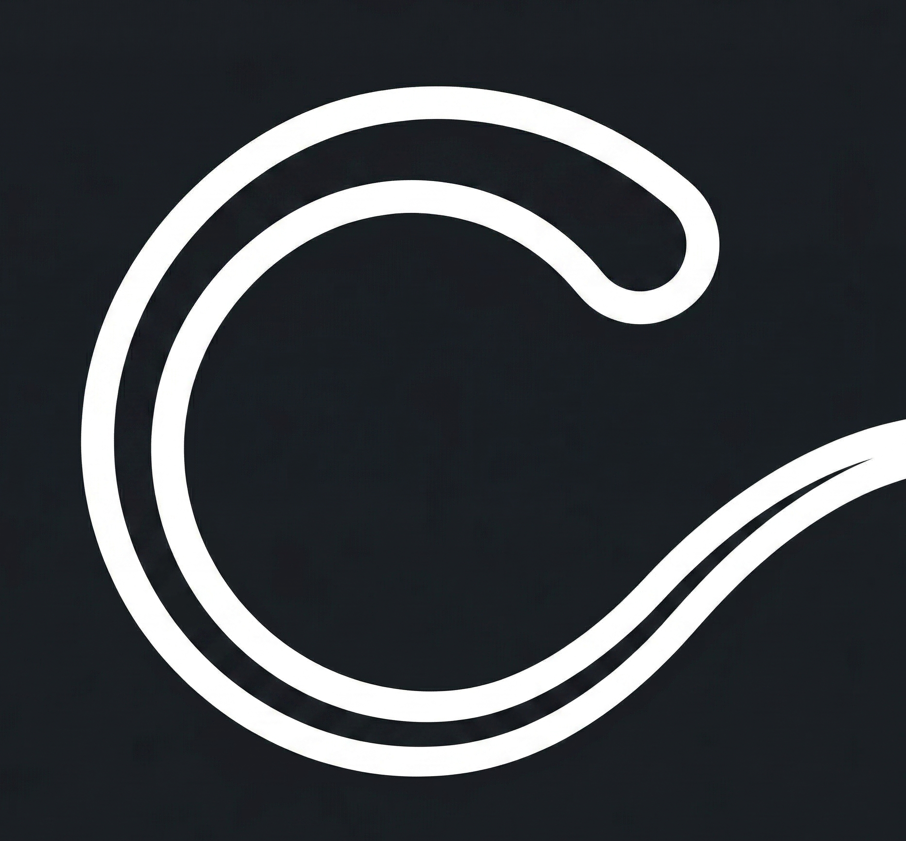
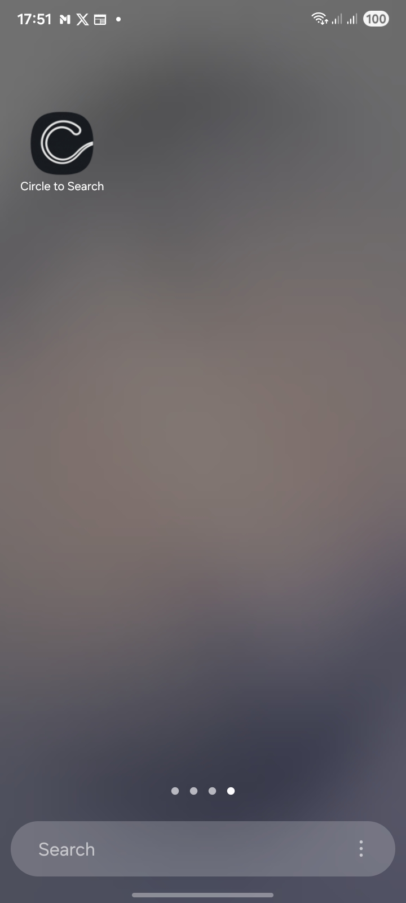
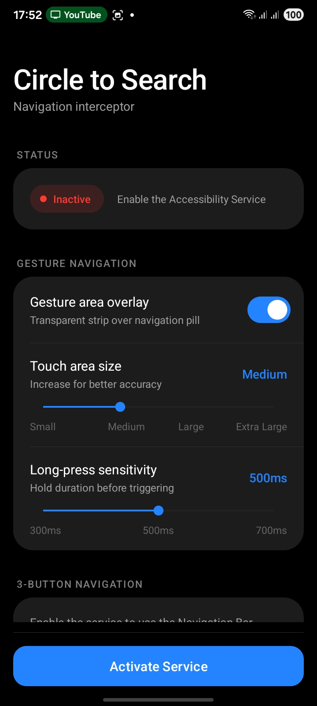
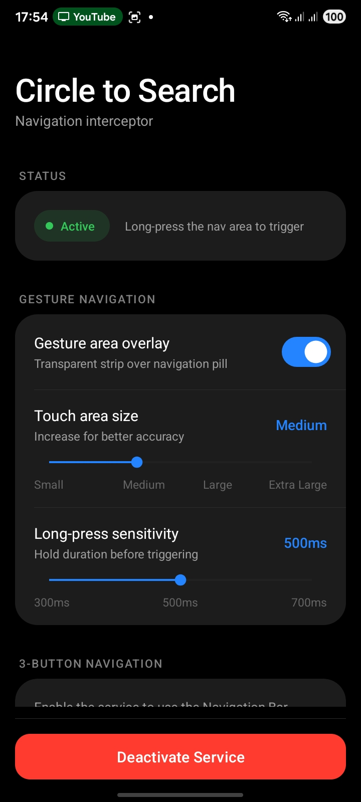
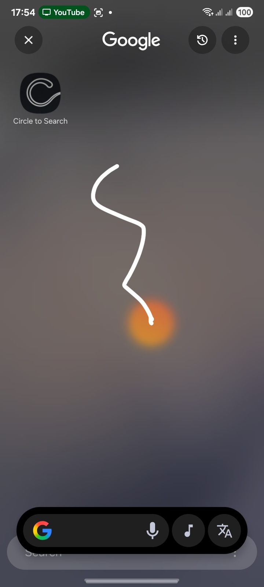
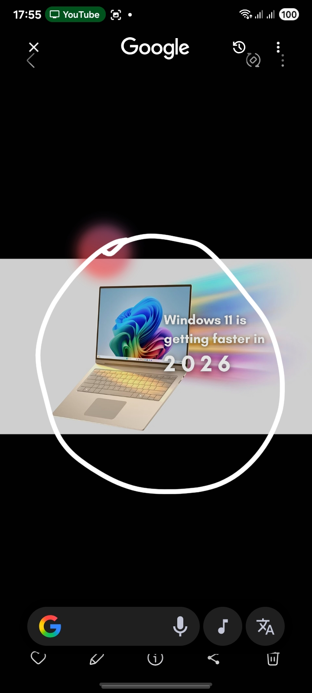
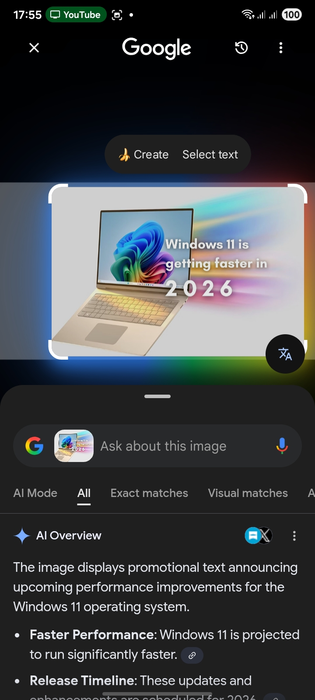

  
  <h1>Circle to Search Helper</h1>
  
<b>A lightweight Android utility to seamlessly invoke Google's Circle to Search via custom gesture overlays and accessibility shortcuts without root.</b>

## ✨ Introduction
Google restricts native invocation for *Circle to Search* on certain models or setups. This lightweight application actively bridges the gap by safely opening the `omni_entry` backdoor using hidden Android APIs. 

Because it operates natively as an **Accessibility Service**, there are no sticky background notifications to worry about, and it completely bypasses the need for the *"Draw over other apps"* permissions that plagued older solutions!

---

## 🚀 Features
- **Native Accessibility Integration:** Clean and robust background summoning of Circle to Search.
- **3-Button Navigation Support:** Adds a dedicated Accessibility Button right onto your nav bar.
- **Gesture Bar Overlay:** A built-in, invisible screen-bottom listener triggers the search when long-pressed.
- **High Customizability:** Easily adjust touch vibration intensity, haptic feedback profiles, and gesture area bounds.
- **No Root Required:** Flawlessly replicates the standard Launcher behaviour out-of-the-box.

---

## 📸 Demo

  
  
  
    
  
  
  

---

## 🛠️ How to Operate

1. **Install and Open:** Launch the application after installation.
2. **Access Settings:** Tap **Accessibility Settings**.
3. **Enable Accessibility Service:**
   - Scroll to **Installed apps** and tap on **Circle to Search**.
   - Turn on the main service switch if it appears.
   - If Settings shows only the **Circle to Search shortcut**, turn it on and tap **Allow**. Enable the shortcut to use the accessibility button.
4. **Trigger your search.**
   - **Using 3-Button Navigation:** Tap the newly added Accessibility (person) shortcut icon anchored to your navigation bar.
   - **Using Gesture Navigation:** Perform a clean long-press at the bottom-center of your screen over the navigation pill. *(Note: The transparent gesture area listener is enabled by default!).*

In the app, open **Search action** and choose **Circle to Search** or **Google Lens**. This choice applies to the long-press gesture, accessibility button, and external shortcut.

To use a back tap, add a **Launch Shortcut** action in [Tap, Tap](https://github.com/KieronQuinn/TapTap) and choose **Trigger search**. You can switch off **Gesture area overlay** if you only want to use the back tap.

When Power saving ends, the app rebuilds the gesture overlay if its accessibility service is still connected, or when Android reconnects it. If Samsung's **Limit apps and Home screen** mode disables the accessibility service in Settings, Android requires you to enable it again. You can add Circle to Search to the allowed apps on Samsung's power-saving Home screen if your device offers it.

---

## 🤝 Contributing
Contributions, issues, and feature requests are highly appreciated! Feel free to check the [issues page](../../issues) and the [CONTRIBUTING.md](./CONTRIBUTING.md) to get started!

---

## 💡 Acknowledgements
- Inspired by [MiCTS](https://github.com/parallelcc/MiCTS).

---

## 📄 License
This project is licensed under the [GNU General Public License v3.0](./LICENSE).

---

  Built with ❤️ by Android Enthusiasts.

